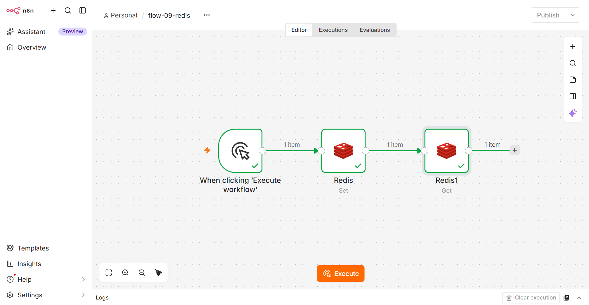
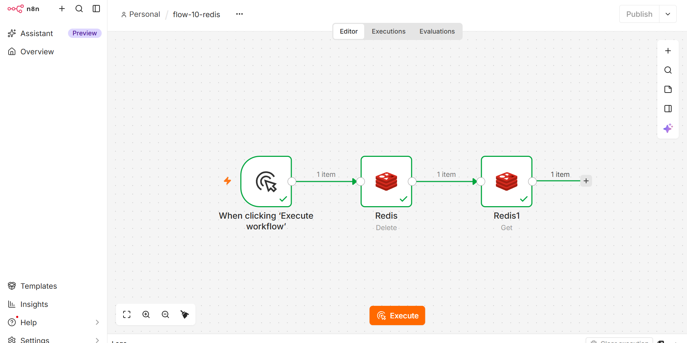

# Redis в лабораторной работе №4

## 1. Установка Redis через Docker

Redis запущен в отдельном Docker-контейнере. Команда запуска:

```bash
docker run -d --name redis -p 6379:6379 redis:7
```

**Разбор параметров:**

| Параметр | Назначение |
|---|---|
| `-d` | Запуск в фоновом режиме (detached) |
| `--name redis` | Имя контейнера |
| `-p 6379:6379` | Проброс порта 6379 (стандартный порт Redis) |
| `redis:7` | Образ Redis версии 7 |

### Проверка работоспособности

```bash
docker ps
```

В списке контейнеров должны быть два: `n8n` и `redis`.

```bash
docker exec -it redis redis-cli ping
```

Ответ: **`PONG`** — Redis работает.

---

## 2. Настройка Credentials в n8n

Для подключения n8n к Redis созданы credentials:

| Поле | Значение |
|---|---|
| **Host** | `host.docker.internal` |
| **Port** | `6379` |
| **Database Number** | `0` |
| **User** | (пусто) |
| **Password** | (пусто) |
| **SSL** | выключено |

### Почему `host.docker.internal`

Контейнер n8n запущен внутри Docker, а Redis — в другом контейнере. Чтобы n8n мог обратиться к сервису на хост-машине (или к другому контейнеру через хост), используется специальный адрес `host.docker.internal`. Docker автоматически резолвит его в IP хост-машины.

После сохранения credentials n8n показал сообщение: **Connection tested successfully**.

---

## 3. Workflow flow-09-redis — создание и чтение ключа

### Схема

```
Manual Trigger → Redis (Set) → Redis (Get)
```

### Настройки нод

**Redis (Set):**
- Credential: `Redis account`
- Operation: `Set`
- Key: `borovik`
- Value: `hello from n8n`

**Redis (Get):**
- Credential: `Redis account`
- Operation: `Get`
- Key: `borovik`

### Результат

После выполнения workflow нода Redis (Get) вернула:

```json
[
  {
    "propertyName": "borovik",
    "value": "hello from n8n"
  }
]
```

Это подтверждает, что ключ был успешно записан и прочитан.

### Скриншот



---

## 4. Workflow flow-10-redis — удаление и проверка

### Схема

```
Manual Trigger → Redis (Delete) → Redis (Get)
```

### Настройки нод

**Redis (Delete):**
- Credential: `Redis account`
- Operation: `Delete`
- Key: `borovik`

**Redis (Get):**
- Credential: `Redis account`
- Operation: `Get`
- Key: `borovik`

### Результат

После выполнения workflow нода Redis (Get) вернула **пустое значение** — это подтверждает, что ключ был удалён и больше не существует.

### Скриншот



---

## 5. Примечание об операции Exists

В задании для второго workflow указана операция **Exists** (проверка существования ключа). Однако в версии n8n **2.43.5** эта операция отсутствует в списке доступных действий Redis.

Доступные операции Redis в n8n 2.43.5:

- Delete a key from Redis
- Get the value of a key from Redis
- Atomically increment a key by 1
- Return generic information about the Redis instance
- Return all keys matching a pattern
- Return the length of a list
- Pop data from a redis list
- Publish message to redis channel
- Push data to a redis list
- Set the value of a key in redis

**Решение:** вместо операции **Exists** использована операция **Get**. Если ключ удалён, Get возвращает пустое значение — это функционально эквивалентно проверке отсутствия ключа.

---

## 6. Выводы

- Redis успешно запущен в Docker и доступен для n8n.
- Настроены credentials с адресом `host.docker.internal` — это позволяет контейнеру n8n обращаться к Redis.
- Освоены основные операции: **Set** (запись), **Get** (чтение), **Delete** (удаление).
- Изучена работа с ключами Redis: создание, чтение значения, удаление и проверка отсутствия.
- Выяснено, что в n8n 2.43.5 операция Exists отсутствует, и найдена её замена — Get с проверкой на пустое значение.

---

## Приложение: команды для работы с Redis через CLI

Проверить значение ключа вручную:

```bash
docker exec -it redis redis-cli GET borovik
```

Посмотреть все ключи:

```bash
docker exec -it redis redis-cli KEYS *
```

Удалить ключ:

```bash
docker exec -it redis redis-cli DEL borovik
```

Проверить существование:

```bash
docker exec -it redis redis-cli EXISTS borovik
# Возвращает 1, если ключ есть, и 0, если нет
```