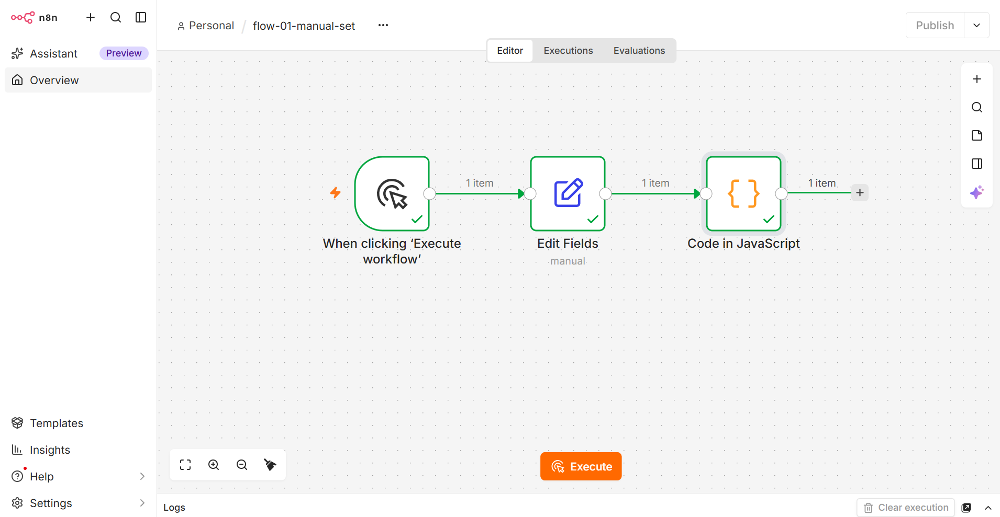
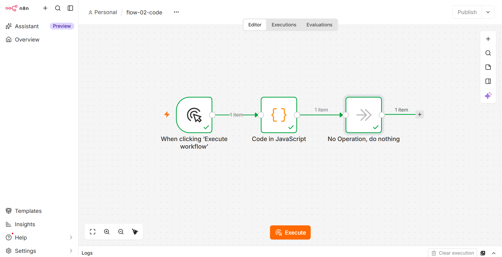
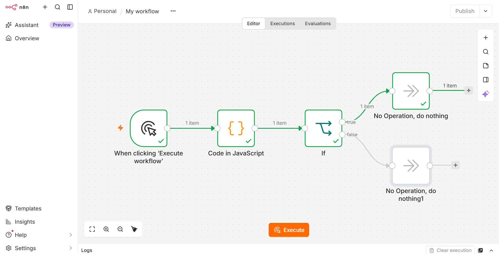
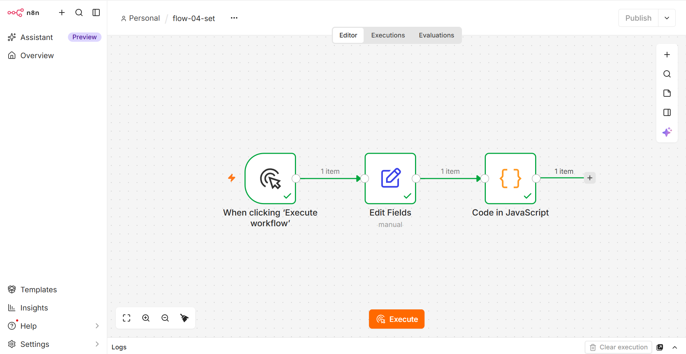
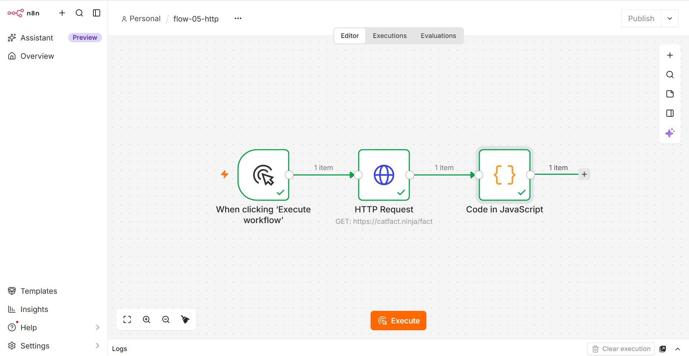
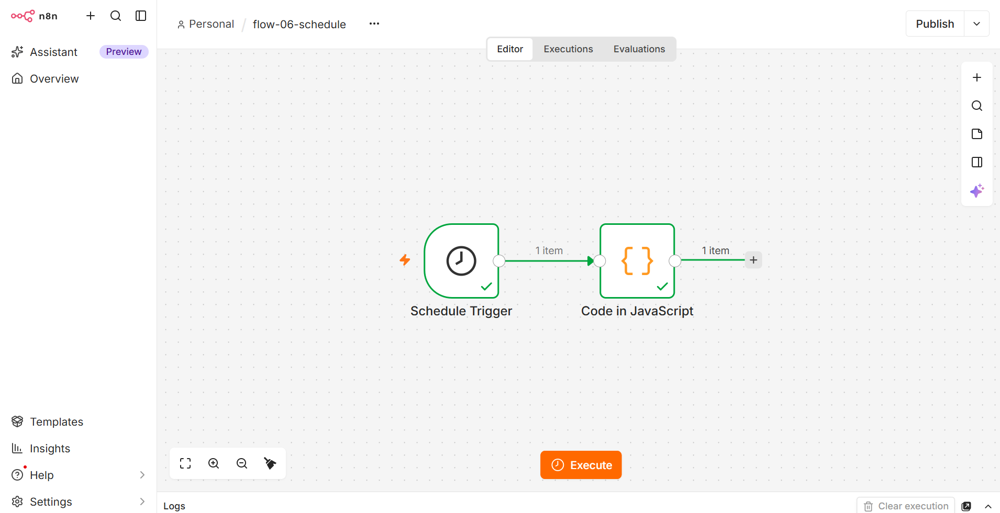

# Лабораторная работа №4. n8n

## Часть 1. Установка и запуск n8n

### Способ установки

n8n установлен через Docker Desktop на Windows 11 с использованием WSL 2.

### Команды запуска

**1. Создание volume для данных n8n:**

```bash
docker volume create n8n_data
```

**2. Запуск контейнера n8n:**

```bash
docker run -it --rm --name n8n -p 5678:5678 -e GENERIC_TIMEZONE="Europe/Moscow" -e TZ="Europe/Moscow" -e N8N_ENFORCE_SETTINGS_FILE_PERMISSIONS=true -v n8n_data:/home/node/.n8n -v ${PWD}/data:/data docker.n8n.io/n8nio/n8n
```

### Параметры запуска

| Параметр | Назначение |
|---|---|
| `--name n8n` | Имя контейнера |
| `-p 5678:5678` | Проброс порта 5678 |
| `-v n8n_data:/home/node/.n8n` | Volume для БД и настроек |
| `-v ${PWD}/data:/data` | Volume для папки /data |
| `-e GENERIC_TIMEZONE`, `-e TZ` | Часовой пояс Europe/Moscow |
| `-e N8N_ENFORCE_SETTINGS_FILE_PERMISSIONS=true` | Проверка прав файла настроек |

### Результат

- n8n версии **2.43.5** успешно запущен.
- Доступен по адресу: `http://localhost:5678`
- Создан owner-аккаунт.

---

## Часть 2. Изучение нод и создание workflow

### 2.1. Manual Trigger → Set → Code (flow-01-manual-set)

**Цель:** Создать данные в Set и вывести их через Code.

**Настройки Set (Edit Fields):**

| Name | Type | Value |
|---|---|---|
| `payload` | String | `Borovik` |
| `topic` | String | `lab4/Borovik/basic` |

**Код Code:**

```javascript
const data = $input.all();
console.log('Данные из Set:', JSON.stringify(data, null, 2));
return data;
```

**Результат OUTPUT:** `{ "payload": "Borovik", "topic": "lab4/Borovik/basic" }`

**Скриншот:**



**Файлы:** `flows/flow-01-manual-set.json`

---

### 2.2. Code node (flow-02-code)

**Цель:** Использовать базовые элементы JS: `let/const`, `if/else`, цикл `for`, массив, объект.

**Схема:** Manual Trigger → Code → NoOp

**Код Code:**

```javascript
const items = [10, 20, 30, 40, 50];
let total = 0;

for (let i = 0; i < items.length; i++) {
  total = total + items[i];
}

let category;
if (total > 100) {
  category = 'big';
} else {
  category = 'small';
}

const result = {
  payload: 'Borovik',
  sum: total,
  count: items.length,
  category: category,
  itemsList: items
};

return [{ json: result }];
```

**Результат OUTPUT:** `sum = 150, count = 5, category = 'big'`

**Скриншот:**



**Файлы:** `flows/flow-02-code.json`

---

### 2.3. IF node (flow-03-if)

**Цель:** Настроить ветвление по полю `payload`.

**Схема:** Manual Trigger → Code → IF → (true) NoOp / (false) NoOp

**Условие IF:**

```
{{ $json.payload }}    is equal to    Borovik
```

**Результат:** Сработала **true-ветка**.

**Скриншот:**



**Файлы:** `flows/flow-03-if.json`

---

### 2.4. Set node (flow-04-set)

**Цель:** Задать `topic`, `timestamp`, `payload` в Set.

**Схема:** Manual Trigger → Set → Code

**Настройки Set:**

| Name | Type | Value |
|---|---|---|
| `payload` | String | `Borovik` |
| `topic` | String | `lab4/Borovik/advanced` |
| `timestamp` | String | `{{ $now }}` |

**Код Code:**

```javascript
const data = $input.all();
console.log('Complete message object:', JSON.stringify(data, null, 2));
return data;
```

**Результат OUTPUT:** объект с `payload`, `topic`, `timestamp`.

**Скриншот:**



**Файлы:** `flows/flow-04-set.json`

---

### 2.5. HTTP Request node (flow-05-http)

**Цель:** GET-запрос к публичному API.

**Схема:** Manual Trigger → HTTP Request → Code

**Настройки HTTP Request:**

- Method: `GET`
- URL: `https://catfact.ninja/fact`
- Response Format: JSON

**Код Code:**

```javascript
const response = $input.first().json;

const result = {
  payload: 'Borovik',
  source: 'catfact.ninja',
  fact: response.fact,
  length: response.length
};

return [{ json: result }];
```

**Скриншот:**



**Файлы:** `flows/flow-05-http.json`

---

### 2.6. Schedule Trigger (flow-06-schedule)

**Цель:** Запуск каждые 5 минут.

**Схема:** Schedule Trigger → Code

**Код Code:**

```javascript
const now = new Date();

const result = {
  payload: 'Borovik',
  triggeredAt: now.toISOString(),
  localTime: now.toLocaleString('ru-RU'),
  schedule: 'every 5 minutes'
};

return [{ json: result }];
```

**Скриншот:**



**Файлы:** `flows/flow-06-schedule.json`

---

## Часть 3. Redis: создание и удаление ключа

### Установка Redis

```bash
docker run -d --name redis -p 6379:6379 redis:7
docker exec -it redis redis-cli ping
```

Ответ: `PONG`

### Credentials в n8n

| Поле | Значение |
|---|---|
| Host | `host.docker.internal` |
| Port | `6379` |
| Database Number | `0` |
| User | (пусто) |
| Password | (пусто) |

Статус: **Connection tested successfully**.

### 3.1. flow-09-redis — создание и чтение ключа

**Схема:** Manual Trigger → Redis (Set) → Redis (Get)

**Redis (Set):** key = `borovik`, value = `hello from n8n`

**Redis (Get):** key = `borovik`

**Результат OUTPUT ноды Get:** `value = hello from n8n`

**Скриншот:**


**Файлы:** `flows/flow-09-redis.json`

---

### 3.2. flow-10-redis — удаление и проверка

**Схема:** Manual Trigger → Redis (Delete) → Redis (Get)

**Результат:** Ключ удалён, значение пустое.

**Скриншот:**


**Файлы:** `flows/flow-10-redis.json`

---
## Часть 5. Выводы

В ходе лабораторной работы я освоила платформу n8n как low-code инструмент автоматизации. Научилась:

1. **Устанавливать n8n через Docker** с двумя volume.
2. **Работать с нодами:** Manual Trigger, Schedule Trigger, Set (Edit Fields), Code, IF, HTTP Request, NoOp.
3. **Настраивать Redis** через Docker, создавать credentials в n8n и работать с ключами: Set, Get, Delete.

Всего создано **8 workflow**.

---

## Использованные AI-промпты

1. «Как запустить n8n через Docker в PowerShell на Windows?»
2. «Как настроить Redis credentials в n8n?»
3. «Почему Docker Desktop не запускается с ошибкой WSL?»
