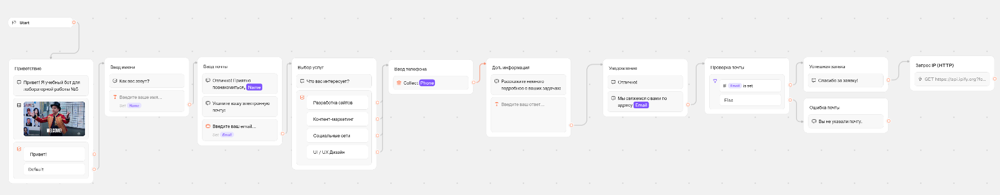
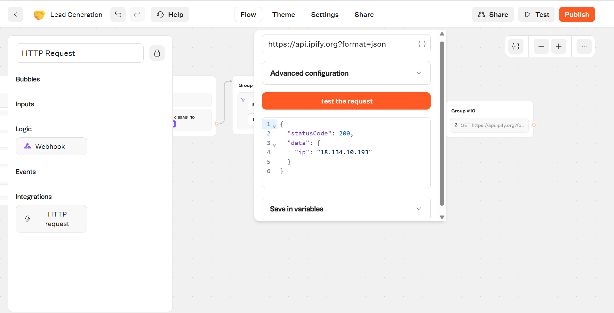
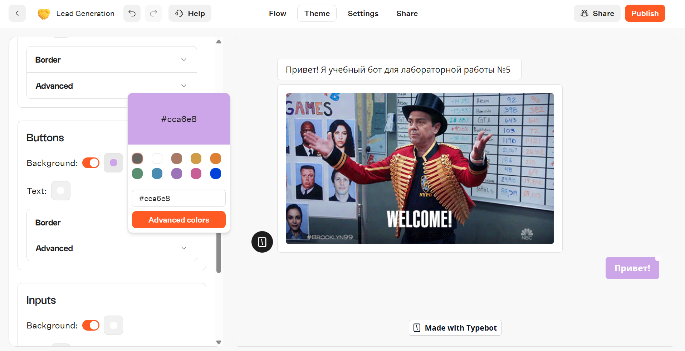
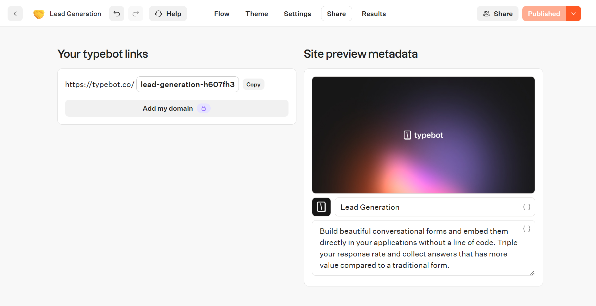

# Лабораторная работа №5. Чат-боты

**Трек:** C. TypeBot

## 1. Краткое описание выбранного трека

TypeBot — это современная low-code/no-code платформа для создания чат-ботов, которая позволяет визуально проектировать сценарии, легко выгружать результаты работы в формате JSON и не имеет проблем с доступом.

**Ссылка на опубликованного бота:** https://typebot.co/lead-generation-h607fh3

## 2. Русификация и внесенные изменения
Для выполнения работы был выбран встроенный шаблон **"Lead Generation"**. 
Все тексты, кнопки, плейсхолдеры (подсказки в полях ввода) и описания были переведены на русский язык. После перевода логика бота и системные переменные (`Name`, `Email`) не сломались.

В исходный шаблон были внесены следующие изменения:
- **Переименованы все блоки** (например, `Welcome` -> `Приветствие`, `Bye` -> `Уведомление`) для того, чтобы схема workflow читалась логично и понятно.
- Добавлен блок **Condition (Условие)** «Проверка почты». Бот проверяет, заполнил ли пользователь переменную `Email` (оператор `is set`).
- Добавлена **новая переменная `Phone`** (блок «Ввод телефона») для сбора контактных данных пользователя.
- Добавлен блок **HTTP Request (Webhook)** для интеграции с внешним сервисом. Бот отправляет GET-запрос по адресу `https://api.ipify.org?format=json`, чтобы получить IP-адрес пользователя (тестовый запрос).
- Изменен **брендинг (Theme)**: цвет кнопок изменен со стандартного оранжевого на сиреневый.

## 3. Использованные AI-промпты
При выполнении лабораторной работы использовались следующие ключевые промпты:
1. *"Какая разница между операторами `is set` и `is not empty` при настройке блока Condition в TypeBot?"*
2. *"Как настроить HTTP Request в TypeBot и какой открытый API можно использовать для тестирования?"*

## 4. Освоенные блоки, ноды и элементы
В ходе работы были успешно освоены следующие элементы визуального конструктора:
- **Bubbles:** Text (текст), Image (картинки).
- **Inputs:** Text, Email, Phone, Buttons (кнопки быстрых ответов).
- **Logic:** Condition (условия ветвления), Set variable (сохранение ответов в переменные).
- **Integrations:** HTTP Request / Webhook (взаимодействие с внешним API).

## 5. Скриншоты workflow и результатов

**Структура созданного бота (Workflow):**

**Настройка и успешный тест HTTP-запроса:**

**Изменение темы и брендинга (сиреневые кнопки):**

**Публикация бота (получение ссылки):**

*(Экспорт JSON находится в папке `exports/`)*

## 6. Выводы
В ходе выполнения лабораторной работы я освоила платформу TypeBot для создания чат-ботов. Я научилась проектировать сценарии (flow), работать с переменными (сохранять и выводить данные), настраивать логические условия (Condition) и интегрировать внешние API через HTTP-запросы. 

Главное преимущество TypeBot — это визуальный редактор и возможность выгрузки готового flow в JSON, что позволяет переносить сценарии. Из ограничений бесплатного тарифа можно выделить наличие брендинга платформы («Made with Typebot») и лимиты на количество просмотров/ответов в месяц.