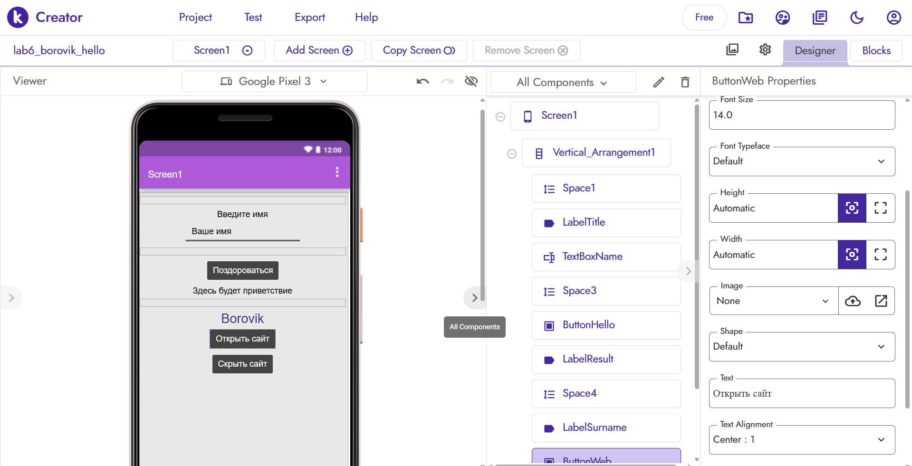
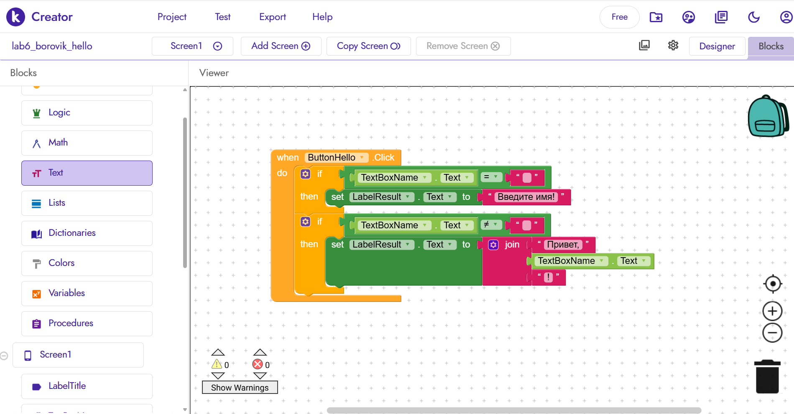
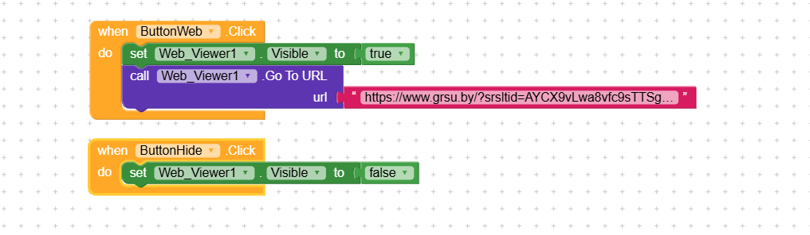
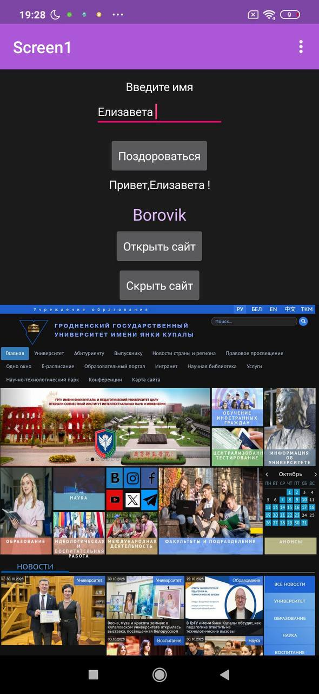

# Лабораторная работа №6. Kodular

## 1. Базовое приложение
Реализован экран приветствия. На экране Screen1 расположены: 
* Label с заголовком «Введите имя»;
* TextBox для ввода имени (свойство Hint = «Ваше имя»);
* Button с текстом «Поздороваться»;
* Label для вывода результата;
* Label с фамилией **Borovik**.

**Логика:** при нажатии на кнопку проверяется, пустое ли поле ввода (используются два условных блока `if`). Если поле пустое — выводится сообщение «Введите имя!». Если имя введено — с помощью блока `join` склеивается строка «Привет, [имя]!» и выводится в нижний Label.
Дизайн оформлен с использованием компонента `Vertical_Arrangement` и отступов `Space` для аккуратного внешнего вида.

**Скриншот дизайна (Screen1):**

**Скриншот базовой логики (блоки):**

## 2. Реализованные ачивки

### Ачивка 9: Web Viewer
**Описание:** Добавлена возможность открывать сайт университета прямо внутри приложения.
**Использованные компоненты:** 
* `WebViewer` (невидим по умолчанию);
* Две кнопки: «Открыть сайт» (`ButtonWeb`) и «Скрыть сайт» (`ButtonHide`).

**Использованные блоки:**
* При нажатии на «Открыть сайт»: свойство `Visible` компонента WebViewer становится `true`, и вызывается метод `GoToUrl` со ссылкой на официальный сайт Гродненского государственного университета имени Янки Купалы (https://www.grsu.by).
* При нажатии на «Скрыть сайт»: свойство `Visible` компонента WebViewer становится `false`, и пользователь снова видит экран приветствия.

**Скриншот логики ачивки (Web Viewer):**

**Скриншот работы приложения (тест на устройстве):**

## 3. Ссылка на проект / файл
Файл проекта: `exports/lab6-borovik.aia`

## 4. AI-промпты
В ходе выполнения работы использовались следующие запросы к ИИ:
1. «Какие блоки нужны для соединения строк (join) в Kodular?»
2. «Как добавить Web Viewer в Kodular и открыть сайт по нажатию на кнопку?»
3. «Как сделать красивое выравнивание элементов по центру в Kodular?»

## 5. Освоенные компоненты и блоки
* **Компоненты:** Label, TextBox, Button, WebViewer, Vertical_Arrangement, Space.
* **Блоки:** `when Click`, `if/then`, `set Text to`, `join`, `WebViewer.GoToUrl`, `WebViewer.Visible`.

## 6. Ограничения бесплатного тарифа Kodular
На бесплатном тарифе Kodular действуют следующие лимиты: до 10 проектов, до 10 МБ ассетов и до 5 расширений (extensions). 
В ходе выполнения данной лабораторной работы я **не столкнулась ни с какими ограничениями**, так как в аккаунте использовался всего один проект, не добавлялись тяжелые медиафайлы (ассеты), а сторонние расширения не использовались вовсе. Текущих возможностей бесплатного тарифа с лихвой хватило для реализации всех поставленных задач.

## 7. Выводы
В ходе работы я освоила визуальную среду разработки Kodular. Я научилась работать с базовыми компонентами интерфейса, настраивать их свойства и создавать логику с помощью визуальных блоков (условия, переменные, работа со строками). Также я реализовала дополнительную функцию (ачивку) с интеграцией веб-браузера. Приложение было успешно протестировано на реальном Android-устройстве через приложение Kodular Companion. Платформа Kodular позволяет быстро создавать рабочие прототипы приложений без написания классического кода.